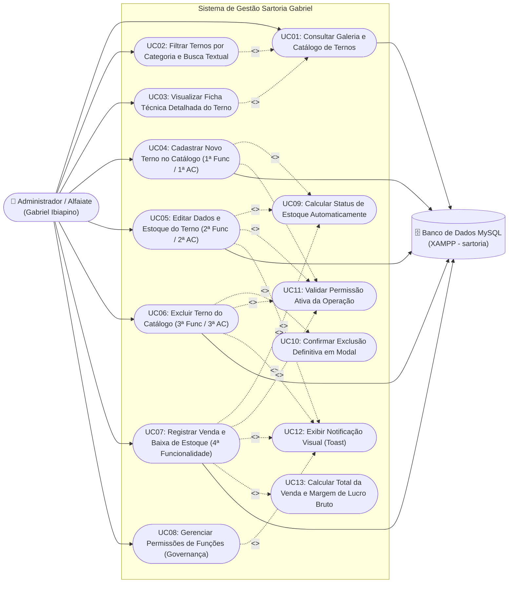

# Diagrama de Casos de Uso — Sartoria Gabriel

> Documentação Funcional, Regras de Negócio e Especificação Detalhada de Casos de Uso do Sistema **Sartoria Gabriel** (contemplando as 4 operações principais: **Inserir**, **Editar**, **Registrar Venda** e **Excluir**, além da **Governança de Permissões**).

---

## 1. Diagrama de Casos de Uso (UML)

---

## 2. Descrição dos Atores

| Ator | Classificação | Responsabilidades no Sistema |
| :--- | :--- | :--- |
| **Administrador / Alfaiate** (`Gabriel Ibiapino`) | **Ator Primário** | Usuário humano que interage diretamente com a interface React para consultar a galeria, gerenciar o catálogo de ternos (**inserir**, **editar**, **registrar vendas** e **excluir**), inspecionar fichas técnicas e configurar a governança de permissões (`canInsert`, `canEdit`, `canSell`, `canDelete`). |
| **Banco de Dados MySQL** (`sartoria`) | **Ator Secundário / Sistema Externo** | Servidor de banco de dados relacional (executado no XAMPP na porta `3306`) acionado pelo backend Express para armazenar, atualizar, registrar baixas de estoque/vendas, consultar e remover registros na tabela `suits`. |

---

## 3. Matriz de Rastreabilidade (Funcionalidades × Casos de Uso)

| Funcionalidade / Etapa | Caso(s) de Uso Relacionado(s) | Componente(s) Frontend | Endpoint Backend | Operação SQL |
| :--- | :--- | :--- | :--- | :--- |
| **1ª Funcionalidade (1ª AC) — Inserir Terno** | `UC04`, `UC09`, `UC11` | `NewSuitModal.tsx`, `Header.tsx`, `CatalogueView.tsx` | `POST /api/suits` | `INSERT INTO suits ...` |
| **2ª Funcionalidade (2ª AC) — Editar Terno** | `UC05`, `UC09`, `UC11`, `UC12` | `EditSuitModal.tsx`, `CatalogueView.tsx`, `SuitDetailsModal.tsx` | `PUT /api/suits/:id` | `UPDATE suits SET ... WHERE id = ?` |
| **3ª Funcionalidade (3ª AC) — Excluir Terno** | `UC06`, `UC10`, `UC11`, `UC12` | `ConfirmModal.tsx`, `CatalogueView.tsx`, `SuitDetailsModal.tsx` | `DELETE /api/suits/:id` | `DELETE FROM suits WHERE id = ?` |
| **4ª Funcionalidade — Registrar Venda e Baixa de Estoque** | `UC07`, `UC09`, `UC11`, `UC12`, `UC13` | `SellSuitModal.tsx`, `CatalogueView.tsx`, `SuitDetailsModal.tsx` | `POST /api/suits/:id/sell` | `UPDATE suits ...` + `INSERT INTO sales ...` |
| **Governança de Acesso (3ª AC)** | `UC08`, `UC11`, `UC12` | `PermissionsModal.tsx`, `Sidebar.tsx` | `localStorage` (`sartoria_permissions`) | — |
| **Prova Final — Gestão e Visão Geral** | `UC01`, `UC02`, `UC03` | `HomeGalleryView.tsx`, `CatalogueView.tsx`, `SuitDetailsModal.tsx` | `GET /api/suits` | `SELECT * FROM suits ORDER BY id DESC` |

---

## 4. Regras de Negócio do Sistema (RN)

| Código | Nome da Regra | Especificação Técnica |
| :--- | :--- | :--- |
| **RN01** | **Cálculo Automático de Status de Estoque** | Sempre que um terno é cadastrado (`POST`), editado (`PUT`) ou vendido (`POST /sell`), o sistema recalcula o status com base no estoque restante (`stock`) e no estoque mínimo (`minStock`, padrão `3`): se `stock === 0`, define `'esgotado'`; se `stock <= minStock`, define `'baixo_estoque'`; caso contrário, define `'disponivel'`. |
| **RN02** | **Geração de Código de Referência Único** | O campo `code` possui restrição `UNIQUE` no banco MySQL. Ao abrir o modal de cadastro, o sistema sugere automaticamente um código no padrão `ALF-XXX` (onde `XXX` é um número aleatório entre `100` e `999`), podendo ser editado pelo usuário. |
| **RN03** | **Governança Dinâmica das 4 Permissões** | As operações de Inserir (`canInsert`), Editar (`canEdit`), Registrar Venda (`canSell`) e Excluir (`canDelete`) são controladas pelo painel de permissões e persistidas em `localStorage` (`sartoria_permissions`). Quando uma função está inativa, seus botões ficam visualmente desabilitados e qualquer tentativa de acionamento é bloqueada com alerta `Toast`. |
| **RN04** | **Exclusão Segura em Duas Etapas** | Nenhum registro pode ser removido diretamente com um único clique. Toda exclusão exige a abertura do modal de confirmação (`ConfirmModal`) exibindo nome, código de referência e categoria do modelo antes de disparar `DELETE /api/suits/:id`. |
| **RN05** | **Validação e Abatimento de Estoque na Venda** | Não é permitido vender uma quantidade superior ao estoque disponível (`quantity <= stock` e `stock > 0`). Ao confirmar a venda, o sistema decrementa `stock` em `quantity`, incrementa `soldCount` em `quantity` e recalcula o `status` do terno atomicamente no MySQL. |
| **RN06** | **Auto-Provisioning do Banco de Dados** | Na inicialização do servidor Express (`initDatabase()`), o backend cria automaticamente o banco `sartoria` (`utf8mb4_unicode_ci`) e a tabela `suits` caso ainda não existam no MySQL do XAMPP. |

---

## 5. Especificação Detalhada dos Casos de Uso

### UC01 — Consultar Galeria e Catálogo de Ternos
- **Atores**: Administrador / Alfaiate (Primário), Banco de Dados MySQL (Secundário).
- **Pré-condições**: O servidor backend (porta `3001`) e o MySQL (porta `3306`) devem estar ativos (ou o fallback local inicializado).
- **Pós-condições**: A lista de ternos é exibida na interface com preços formatados em `R$` e indicadores visuais de estoque.
- **Fluxo Principal**:
  1. O Administrador acessa o sistema ou alterna entre as abas **"Início (Galeria)"** e **"Catálogo de Ternos"** na `Sidebar`.
  2. O frontend invoca `fetchSuits()` enviando uma requisição `GET /api/suits`.
  3. O backend executa `SELECT * FROM suits ORDER BY id DESC` no MySQL e retorna a lista em JSON.
  4. O sistema renderiza o grid de cards exibindo fotografia, categoria, código (`Ref`), tamanho, tecido, quantidade em estoque e preço de venda.
  5. Para itens cujo `stock <= minStock`, o sistema destaca o badge de estoque na cor vermelha (`rose`).
- **Fluxo Alternativo (FA01 — Catálogo Vazio)**:
  - Se o banco de dados não possuir nenhum terno cadastrado (`suits.length === 0`), o sistema exibe o estado vazio (`Empty State` com ícone `PackageOpen`) orientando o usuário a cadastrar o primeiro terno.
- **Fluxo de Exceção (FE01 — Servidor Backend Indisponível)**:
  - Caso a requisição HTTP falhe, `fetchSuits()` captura o erro, registra um aviso no console e utiliza os dados de fallback local (`initialSuits` / IndexedDB) sem quebrar a interface.

---

### UC02 — Filtrar Ternos por Categoria e Busca Textual
- **Atores**: Administrador / Alfaiate.
- **Relacionamento**: `<<extend>>` de `UC01`.
- **Pré-condições**: Listagem de ternos carregada (`UC01`).
- **Pós-condições**: O grid exibe apenas os ternos que correspondem simultaneamente à categoria selecionada e ao texto pesquisado.
- **Fluxo Principal**:
  1. O Administrador clica em uma das pílulas de categoria (`Todos os Modelos`, `Sob Medida`, `Slim Fit Italiano`, `Smoking / Black Tie`, `Linho Puro Riviera`, `Cerimonial & Noivos`, `Clássico Executivo`) e/ou digita um termo no campo de busca.
  2. O sistema filtra reativamente a lista verificando se a categoria coincide e se o termo digitado está contido no `name`, `fabric`, `code` ou `color`.
  3. O grid é atualizado instantaneamente sem necessidade de nova requisição ao servidor.
- **Fluxo Alternativo (FA01 — Nenhum Resultado para o Filtro)**:
  - Se existem ternos no banco, mas nenhum atende ao filtro aplicado (`filteredSuits.length === 0`), o sistema exibe a mensagem *"Nenhum terno encontrado para este filtro"*.

---

### UC03 — Visualizar Ficha Técnica Detalhada do Terno
- **Atores**: Administrador / Alfaiate.
- **Relacionamento**: `<<extend>>` de `UC01`.
- **Pré-condições**: Pelo menos um terno está visível na Galeria ou no Catálogo.
- **Pós-condições**: O modal `SuitDetailsModal` é exibido com todas as informações técnicas, comerciais e financeiras da peça.
- **Fluxo Principal**:
  1. O Administrador clica sobre o card de um terno na Galeria ou no botão **"Ver detalhes"** (`ShoppingBag`) no Catálogo.
  2. O sistema abre o `SuitDetailsModal` exibindo imagem ampliada, categoria, nome, código de referência, tecido nobre, cor, tamanho, estoque atual, **total vendido (`soldCount`)**, status (`disponivel`, `baixo estoque` ou `esgotado`), **Preço de Venda** e **Preço de Custo**.
  3. A partir deste modal, o Administrador pode fechar a janela ou acionar diretamente os botões **"Registrar Venda"** (`UC07`), **"Editar Terno"** (`UC05`) ou **"Excluir"** (`UC06`).

---

### UC04 — Cadastrar Novo Terno no Catálogo (1ª Funcionalidade / 1ª AC)
- **Atores**: Administrador / Alfaiate (Primário), Banco de Dados MySQL (Secundário).
- **Relacionamentos**: `<<include>>` `UC09` (Calcular Status de Estoque), `<<include>>` `UC11` (Validar Permissão).
- **Pré-condições**: A permissão `canInsert` deve estar **Ativa** (`true`).
- **Pós-condições**: Um novo modelo de terno é persistido na tabela `suits` do MySQL e exibido imediatamente no catálogo.
- **Fluxo Principal**:
  1. Na aba **"Catálogo de Ternos"**, o Administrador clica no botão **"Cadastrar Terno"** no cabeçalho (ou **"Cadastrar Primeiro Terno"** no estado vazio).
  2. O sistema valida se `canInsert` está ativo (`UC11`) e abre o `NewSuitModal` com um código `ALF-XXX` pré-gerado (`RN02`).
  3. O Administrador preenche os campos obrigatórios: Nome do Modelo, Código/Referência, Categoria, Composição do Tecido, Cor Principal, Tamanho Padrão, Preço de Venda, Preço de Custo, Estoque Inicial, além dos campos opcionais Estoque Mínimo e URL da Imagem.
  4. O Administrador clica em **"Salvar"**.
  5. O sistema calcula automaticamente o `status` do estoque (`UC09` / `RN01`) e envia uma requisição `POST /api/suits`.
  6. O backend Express gera o identificador único `s-${Date.now()}`, executa `INSERT INTO suits` no MySQL e retorna HTTP `201 Created`.
  7. O modal é fechado e a listagem do catálogo é recarregada com o novo terno.
- **Fluxo de Exceção (FE01 — Permissão de Cadastro Inativa)**:
  - Se `canInsert === false`, o botão no cabeçalho aparece desabilitado como **"Cadastro Inativo"**. Caso a ação seja disparada, o sistema bloqueia a abertura do modal e exibe um `Toast` de erro: *"Função bloqueada: O cadastro de ternos foi inativado pelo administrador"*.

---

### UC05 — Editar Dados e Estoque do Terno (2ª Funcionalidade / 2ª AC)
- **Atores**: Administrador / Alfaiate (Primário), Banco de Dados MySQL (Secundário).
- **Relacionamentos**: `<<include>>` `UC09` (Calcular Status de Estoque), `<<include>>` `UC11` (Validar Permissão), `<<include>>` `UC12` (Exibir Toast).
- **Pré-condições**: O terno deve existir no catálogo e a permissão `canEdit` deve estar **Ativa** (`true`).
- **Pós-condições**: Os dados do terno são atualizados no MySQL, o status de estoque é recalculado e uma notificação de sucesso é exibida.
- **Fluxo Principal**:
  1. O Administrador clica no botão **"Editar"** (`Pencil`) no card do terno no Catálogo ou dentro da Ficha Técnica (`SuitDetailsModal`).
  2. O sistema valida a permissão `canEdit` (`UC11`) e abre o `EditSuitModal` com todos os campos preenchidos com os valores atuais do modelo.
  3. O Administrador altera os dados desejados (preço de venda, preço de custo, estoque atual, estoque mínimo, tecido, categoria, cor, tamanho ou imagem) e clica em **"Salvar Alterações"**.
  4. O sistema recalcula o status de estoque (`UC09` / `RN01`) e envia uma requisição `PUT /api/suits/:id`.
  5. O backend Express executa `UPDATE suits SET ... WHERE id = ?` no banco MySQL e retorna `{ success: true }`.
  6. O sistema atualiza o cache local, fecha o modal, recarrega a lista de ternos e exibe um `Toast` verde de sucesso (`UC12`): *"Terno atualizado com sucesso"*.
- **Fluxo de Exceção (FE01 — Permissão de Edição Inativa)**:
  - Se `canEdit === false`, os botões de edição ficam desabilitados (`Edição Inativa`). Se acionada, a função é bloqueada com `Toast` de erro.

---

### UC06 — Excluir Terno do Catálogo (3ª Funcionalidade / 3ª AC)
- **Atores**: Administrador / Alfaiate (Primário), Banco de Dados MySQL (Secundário).
- **Relacionamentos**: `<<include>>` `UC10` (Confirmar Exclusão em Modal), `<<include>>` `UC11` (Validar Permissão), `<<include>>` `UC12` (Exibir Toast).
- **Pré-condições**: O terno deve estar cadastrado e a permissão `canDelete` deve estar **Ativa** (`true`).
- **Pós-condições**: O registro do terno é removido permanentemente da tabela `suits` no MySQL e do cache local.
- **Fluxo Principal**:
  1. O Administrador clica no botão **"Excluir"** (`Trash2`) no card do terno no Catálogo ou dentro da Ficha Técnica.
  2. O sistema valida a permissão `canDelete` (`UC11`) e abre o modal de confirmação `ConfirmModal` (`UC10`), exibindo o resumo do item: `<Nome> (Ref: <Código>) • Categoria: <Categoria>`.
  3. O Administrador confirma a operação clicando em **"Excluir Definitivamente"**.
  4. O sistema exibe o estado `"Excluindo..."` e envia a requisição `DELETE /api/suits/:id`.
  5. O backend Express executa `DELETE FROM suits WHERE id = ?` no MySQL e retorna `{ success: true }`.
  6. O sistema remove o item do cache local, fecha o modal de confirmação, atualiza a listagem e exibe um `Toast` de sucesso (`UC12`): *"Terno excluído com sucesso"*.
- **Fluxo Alternativo (FA01 — Cancelamento da Exclusão)**:
  - No passo 3, caso o Administrador clique em **"Cancelar"** ou no botão `X`, o `ConfirmModal` é fechado e nenhuma alteração é feita no banco de dados.

---

### UC07 — Registrar Venda e Baixa de Estoque (4ª Funcionalidade)
- **Atores**: Administrador / Alfaiate (Primário), Banco de Dados MySQL (Secundário).
- **Relacionamentos**: `<<include>>` `UC09` (Calcular Status de Estoque), `<<include>>` `UC11` (Validar Permissão), `<<include>>` `UC12` (Exibir Toast), `<<include>>` `UC13` (Calcular Total da Venda e Margem de Lucro).
- **Pré-condições**: O terno deve possuir unidades disponíveis em estoque (`stock > 0`) e a permissão `canSell` deve estar **Ativa** (`true`).
- **Pós-condições**: O estoque (`stock`) do terno é decrementado pela quantidade vendida, o contador de vendas (`soldCount`) é incrementado, o `status` é atualizado (`disponivel`, `baixo_estoque` ou `esgotado`) no MySQL e uma notificação `Toast` detalhada é exibida.
- **Fluxo Principal**:
  1. O Administrador clica no botão **"Registrar Venda"** (`BadgeDollarSign`) no card do terno no Catálogo ou no rodapé da Ficha Técnica (`SuitDetailsModal`).
  2. O sistema valida se `canSell` está ativo (`UC11`) e abre o modal `SellSuitModal`.
  3. O sistema exibe o resumo do terno (foto, categoria, nome, tamanho, preço unitário e estoque atual).
  4. O Administrador preenche o nome do cliente (opcional), seleciona a forma de pagamento (`PIX`, `Cartão de Crédito`, `Cartão de Débito` ou `Transferência / TED`) e informa a quantidade vendida (`1` até `stock`).
  5. O sistema calcula em tempo real (`UC13`):
     - **Estoque Pós-Venda**: `stock - quantity` (indicando visualmente se ficará em baixo estoque ou esgotado).
     - **Valor Total da Venda**: `price * quantity`.
     - **Margem / Lucro Bruto Estimado**: `(price - costPrice) * quantity`.
  6. O Administrador clica em **"Confirmar Venda"**.
  7. O frontend envia uma requisição `POST /api/suits/:id/sell` com `{ quantity, customerName, paymentMethod }`.
  8. O backend Express valida a disponibilidade no MySQL, calcula o novo estoque (`newStock`), incrementa `soldCount` e recalcula o `status` (`UC09` / `RN01`, `RN05`), executando duas operações no banco `sartoria`:
     - `UPDATE suits SET stock = ?, soldCount = ?, status = ? WHERE id = ?` (baixa de estoque na tabela `suits`).
     - `INSERT INTO sales (id, suitId, suitCode, suitName, customerName, paymentMethod, quantity, unitPrice, totalPrice, profit) VALUES (...)` (registro completo da venda na tabela `sales`).
  9. O sistema atualiza o cache local, fecha o modal, recarrega o catálogo e exibe um `Toast` de sucesso (`UC12`) informando a quantidade vendida, o valor total em `R$` e o estoque restante.
- **Fluxo de Exceção (FE01 — Permissão de Venda Inativa)**:
  - Se `canSell === false`, os botões de venda ficam desabilitados (`Venda Inativa`). Qualquer tentativa de acionamento exibe `Toast` de bloqueio.
- **Fluxo de Exceção (FE02 — Estoque Esgotado ou Insuficiente)**:
  - Se `stock === 0`, o botão de venda fica desabilitado com indicação de *"Esgotado"*. Caso o backend receba uma quantidade maior que o estoque atual no banco, retorna HTTP `400 Bad Request` (`"Estoque insuficiente para realizar esta venda"`).

---

### UC08 — Gerenciar Permissões de Funções (Governança)
- **Atores**: Administrador / Alfaiate.
- **Relacionamento**: `<<include>>` `UC12` (Exibir Toast).
- **Pré-condições**: O Administrador está operando o painel principal.
- **Pós-condições**: As 4 permissões (`canInsert`, `canEdit`, `canSell` e `canDelete`) são atualizadas em tempo real na interface e persistidas no `localStorage`.
- **Fluxo Principal**:
  1. O Administrador clica no botão do seu perfil (**Gabriel Ibiapino — Administrador**) localizado na base da `Sidebar`.
  2. O sistema abre o modal **"Controle de Funções"** (`PermissionsModal`), listando as **4 operações governáveis** com seus respectivos *switches* (`Ativo` / `Inativo`):
     - **Inserir Ternos (Cadastro)** (`canInsert`)
     - **Editar Ternos** (`canEdit`)
     - **Registrar Vendas (Baixa de Estoque)** (`canSell`)
     - **Excluir Ternos** (`canDelete`)
  3. O Administrador alterna os *switches* desejados e clica em **"Salvar Alterações"**.
  4. O sistema atualiza o estado `permissions`, grava o JSON na chave `sartoria_permissions` do `localStorage`, fecha o modal e exibe o `Toast` de confirmação (`UC12`): *"Permissões atualizadas com sucesso"*.
  5. Todos os botões correspondentes no Cabeçalho, Catálogo e Ficha Técnica refletem imediatamente o novo estado de permissão.
