# Diagrama de Classes — Sartoria Gabriel

> Documentação Técnica de Arquitetura e Modelagem Orientada a Objetos do Sistema **Sartoria Gabriel** (incluindo as 4 funcionalidades principais: **Inserir**, **Editar**, **Registrar Venda** e **Excluir**).

---

## 1. Visão Arquitetural em Camadas

O sistema segue uma arquitetura **Full-Stack em 4 Camadas** claramente separadas:

1. **Camada de Apresentação e Controle de Visão (`src/components/` e `src/App.tsx`)**: Componentes React 19 tipados com TypeScript que gerenciam estado de interface, filtros, modais operacionais (Cadastro, Edição, Venda e Exclusão) e controle de permissões.
2. **Camada de Domínio e Tipos (`src/types/index.ts` e `src/utils/formatters.ts`)**: Interfaces de negócio (`Suit`, `UserPermissions`), tipos enumerados (`SuitCategory`, `SuitStatus`) e utilitários de formatação monetária.
3. **Camada de Serviços e Cache Local (`src/services/api.ts` e `src/db/database.ts`)**: Cliente HTTP Fetch para comunicação com a API REST e banco local IndexedDB via `Dexie.js`.
4. **Camada de Backend e Persistência Relacional (`server/index.ts` e `server/db.ts`)**: Servidor RESTful Express 5 integrado ao banco de dados **MySQL / MariaDB** via pool de conexões `mysql2/promise`.

---

## 2. Diagrama de Classes Completo (UML)

```mermaid
classDiagram
    direction TB

    %% ==========================================
    %% CAMADA DE DOMÍNIO E TIPOS (src/types)
    %% ==========================================
    class Suit {
        <<Entity / Interface>>
        +string id
        +string code
        +string name
        +SuitCategory category
        +string fabric
        +string color
        +string colorHex
        +string size
        +number price
        +number costPrice
        +number stock
        +number minStock
        +string image
        +SuitStatus status
        +number soldCount
    }

    class Sale {
        <<Entity / Table sales>>
        +string id
        +string suitId
        +string suitCode
        +string suitName
        +string customerName
        +string paymentMethod
        +number quantity
        +number unitPrice
        +number totalPrice
        +number profit
        +Date soldAt
    }

    class SuitCategory {
        <<enumeration>>
        Sob Medida
        Slim Fit Italiano
        Cerimonial e Noivos
        Smoking / Black Tie
        Linho Puro Riviera
        Classico Executivo
    }

    class SuitStatus {
        <<enumeration>>
        disponivel
        baixo_estoque
        esgotado
        em_ajuste
    }

    class UserPermissions {
        <<Value Object / Interface>>
        +boolean canInsert
        +boolean canEdit
        +boolean canDelete
        +boolean canSell
    }

    class ToastMessage {
        <<Value Object / Interface>>
        +string id
        +string type
        +string title
        +string description
    }

    class Formatters {
        <<Utility>>
        +formatCurrency(value: number)$ string
    }

    %% ==========================================
    %% CAMADA DE APRESENTAÇÃO (React Components)
    %% ==========================================
    class App {
        <<React Root Controller>>
        -string activeTab
        -boolean isSuitModalOpen
        -Suit selectedSuit
        -Suit editingSuit
        -Suit sellingSuit
        -boolean isPermissionsModalOpen
        -Suit deletingSuit
        -boolean isDeleting
        -UserPermissions permissions
        -ToastMessage[] toasts
        -Suit[] serverSuits
        -Suit[] liveSuits
        +loadData() Promise~void~
        +handleSavePermissions(newPermissions: UserPermissions) void
        +handleDeleteSuit(suit: Suit) void
        +handleConfirmDelete() Promise~void~
        +showToast(type: string, title: string, description?: string) void
        +dismissToast(id: string) void
    }

    class Sidebar {
        <<React Component>>
        +string activeTab
        +setActiveTab(tab: string) void
        +onOpenPermissions() void
    }

    class Header {
        <<React Component>>
        +string activeTab
        +boolean canInsert
        +onOpenNewSuit() void
        -getPageTitle() string
    }

    class HomeGalleryView {
        <<React Component>>
        +Suit[] suits
        -string selectedCategory
        -string search
        +onSelectSuit(suit: Suit) void
        -filterSuits() Suit[]
    }

    class CatalogueView {
        <<React Component>>
        +Suit[] suits
        +boolean canInsert
        +boolean canEdit
        +boolean canDelete
        +boolean canSell
        -string selectedCategory
        -string search
        +onSelectSuit(suit: Suit) void
        +onEditSuit(suit: Suit) void
        +onSellSuit(suit: Suit) void
        +onDeleteSuit(suit: Suit) void
        +onOpenNewSuit() void
        -filterSuits() Suit[]
    }

    class NewSuitModal {
        <<React Component - 1a Func: Inserir>>
        +boolean isOpen
        -string name
        -string code
        -SuitCategory category
        -string fabric
        -string color
        -string size
        -string price
        -string costPrice
        -string stock
        -string minStock
        -string image
        -boolean isSubmitting
        +onClose() void
        +onSuccess() void
        +resetForm() void
        +handleClose() void
        +handleSubmit(e: FormEvent) Promise~void~
    }

    class EditSuitModal {
        <<React Component - 2a Func: Editar>>
        +Suit suit
        +boolean isOpen
        -string name
        -string code
        -SuitCategory category
        -string fabric
        -string color
        -string size
        -string price
        -string costPrice
        -string stock
        -string minStock
        -string image
        -boolean isSubmitting
        +onClose() void
        +onSuccess() void
        +onToast(type: string, title: string, description?: string) void
        +handleSubmit(e: FormEvent) Promise~void~
    }

    class SellSuitModal {
        <<React Component - 4a Func: Vender>>
        +Suit suit
        +boolean isOpen
        -number quantity
        -string customerName
        -string paymentMethod
        -boolean isSubmitting
        +onClose() void
        +onSuccess() void
        +onToast(type: string, title: string, description?: string) void
        +handleSubmit(e: FormEvent) Promise~void~
    }

    class SuitDetailsModal {
        <<React Component>>
        +Suit suit
        +boolean canEdit
        +boolean canDelete
        +boolean canSell
        +onClose() void
        +onEditSuit(suit: Suit) void
        +onSellSuit(suit: Suit) void
        +onDeleteSuit(suit: Suit) void
    }

    class PermissionsModal {
        <<React Component - Governanca>>
        +boolean isOpen
        +UserPermissions permissions
        -boolean canInsert
        -boolean canEdit
        -boolean canDelete
        -boolean canSell
        +onClose() void
        +onSavePermissions(newPermissions: UserPermissions) void
        +handleSave() void
    }

    class ConfirmModal {
        <<React Component - 3a Func: Excluir>>
        +boolean isOpen
        +string title
        +string message
        +string detail
        +string confirmLabel
        +string cancelLabel
        +boolean isLoading
        +onConfirm() void
        +onCancel() void
    }

    class Toast {
        <<React Component>>
        +ToastMessage[] toasts
        +onDismiss(id: string) void
    }

    %% ==========================================
    %% CAMADA DE SERVIÇOS E DADOS LOCAIS
    %% ==========================================
    class SuitApiService {
        <<Frontend HTTP Service>>
        -string API_BASE
        +fetchSuits()$ Promise~Suit[]~
        +createSuit(data: Partial~Suit~)$ Promise~boolean~
        +updateSuit(id: string, data: Partial~Suit~)$ Promise~boolean~
        +sellSuit(id: string, quantity: number)$ Promise~boolean~
        +deleteSuit(id: string)$ Promise~boolean~
    }

    class SuitStoreDatabase {
        <<Dexie / IndexedDB>>
        +Table~Suit, string~ suits
        +Suit[] initialSuits
        +initializeDatabase()$ Promise~void~
    }

    %% ==========================================
    %% CAMADA DE BACKEND E BANCO DE DADOS MYSQL
    %% ==========================================
    class ExpressSuitController {
        <<Backend REST Controller>>
        -number PORT
        -string distPath
        +getSuits(req: Request, res: Response) Promise~void~
        +createSuit(req: Request, res: Response) Promise~void~
        +updateSuit(req: Request, res: Response) Promise~void~
        +sellSuit(req: Request, res: Response) Promise~void~
        +deleteSuit(req: Request, res: Response) Promise~void~
    }

    class MySQLDatabase {
        <<Database Connection Pool>>
        -string DB_HOST
        -number DB_PORT
        -string DB_USER
        -string DB_PASSWORD
        -string DB_NAME
        +Pool pool
        +initDatabase()$ Promise~void~
    }

    %% ==========================================
    %% RELACIONAMENTOS UML
    %% ==========================================
    Suit "1" --> "1" SuitCategory : classificado em
    Suit "1" --> "1" SuitStatus : possui estado
    Suit "1" --> "0..*" Sale : gera histórico de vendas

    App "1" *-- "1" UserPermissions : gerencia estado
    App "1" *-- "0..*" ToastMessage : mantém fila
    App "1" o-- "0..*" Suit : carrega e exibe

    App "1" *-- "1" Sidebar : compõe layout
    App "1" *-- "1" Header : compõe layout
    App "1" *-- "0..1" HomeGalleryView : renderiza aba inicio
    App "1" *-- "0..1" CatalogueView : renderiza aba catalogo
    App "1" *-- "1" NewSuitModal : controla modal
    App "1" *-- "1" EditSuitModal : controla modal
    App "1" *-- "1" SellSuitModal : controla modal
    App "1" *-- "1" SuitDetailsModal : controla modal
    App "1" *-- "1" PermissionsModal : controla modal
    App "1" *-- "1" ConfirmModal : controla modal
    App "1" *-- "1" Toast : renderiza alertas

    HomeGalleryView ..> Formatters : formata preço (R$)
    CatalogueView ..> Formatters : formata preço (R$)
    SuitDetailsModal ..> Formatters : formata preços (R$)
    SellSuitModal ..> Formatters : formata total e lucro (R$)

    App ..> SuitApiService : fetchSuits() / deleteSuit()
    NewSuitModal ..> SuitApiService : createSuit()
    EditSuitModal ..> SuitApiService : updateSuit()
    SellSuitModal ..> SuitApiService : sellSuit()

    App ..> SuitStoreDatabase : useLiveQuery() / delete()
    NewSuitModal ..> SuitStoreDatabase : db.suits.add()
    EditSuitModal ..> SuitStoreDatabase : db.suits.update()
    SellSuitModal ..> SuitStoreDatabase : db.suits.update()
    SuitApiService ..> SuitStoreDatabase : fallback initialSuits
    SuitStoreDatabase "1" *-- "0..*" Suit : armazena em IndexedDB

    SuitApiService ..> ExpressSuitController : HTTP JSON (/api/suits)
    ExpressSuitController ..> MySQLDatabase : pool.query()
    MySQLDatabase "1" *-- "0..*" Suit : persiste em sartoria.suits
    MySQLDatabase "1" *-- "0..*" Sale : persiste em sartoria.sales
```

---

## 3. Dicionário de Dados das Entidades (`Suit` / `suits` e `Sale` / `sales`)

Abaixo está o mapeamento exato entre as entidades do sistema e a estrutura física das tabelas `suits` e `sales` no MySQL ([server/db.ts](file:///C:/Users/Lenovo/Dev/Gabriel/server/db.ts)):

### 3.1. Tabela `suits` (Catálogo e Estoque de Ternos)

| Atributo | Tipo TypeScript | Tipo MySQL (`sartoria.suits`) | Restrições / Default | Descrição Detalhada |
| :--- | :--- | :--- | :--- | :--- |
| **`id`** | `string` | `VARCHAR(64)` | `PRIMARY KEY` | Identificador único gerado via timestamp (`s-${Date.now()}`). |
| **`code`** | `string` | `VARCHAR(64)` | `NOT NULL UNIQUE` | Código de referência comercial da peça (ex.: `ALF-101`). |
| **`name`** | `string` | `VARCHAR(255)` | `NOT NULL` | Nome comercial/descritivo do modelo do terno. |
| **`category`** | `SuitCategory` | `VARCHAR(100)` | `NOT NULL` | Corte ou linha de alfaiataria (`Sob Medida`, `Slim Fit Italiano`, etc.). |
| **`fabric`** | `string` | `VARCHAR(255)` | `NOT NULL` | Composição do tecido nobre (ex.: `Lã Fria Super 150s`, `Linho Irlandês`). |
| **`color`** | `string` | `VARCHAR(100)` | `NOT NULL` | Nome da cor principal do terno (ex.: `Azul Marinho Imperial`). |
| **`colorHex`** | `string` | `VARCHAR(50)` | `NOT NULL DEFAULT '#0f172a'` | Código hexadecimal representativo da cor. |
| **`size`** | `string` | `VARCHAR(50)` | `NOT NULL` | Numeração/corte do terno (ex.: `48L`, `50R`, `52R`, `Sob Medida`). |
| **`price`** | `number` | `DECIMAL(10, 2)` | `NOT NULL DEFAULT 0.00` | Preço de venda ao cliente final em Reais (`R$`). |
| **`costPrice`** | `number` | `DECIMAL(10, 2)` | `NOT NULL DEFAULT 0.00` | Preço de custo de confecção/aquisição em Reais (`R$`). |
| **`stock`** | `number` | `INT(11)` | `NOT NULL DEFAULT 0` | Quantidade atual de unidades disponíveis em estoque (decrementado a cada venda). |
| **`minStock`** | `number` | `INT(11)` | `NOT NULL DEFAULT 3` | Limite mínimo de segurança para alerta de reposição. |
| **`image`** | `string` | `TEXT` | `NOT NULL` | URL da fotografia do modelo de terno. |
| **`status`** | `SuitStatus` | `VARCHAR(50)` | `NOT NULL DEFAULT 'disponivel'` | Estado calculado automaticamente (`disponivel`, `baixo_estoque` ou `esgotado`). |
| **`soldCount`** | `number` | `INT(11)` | `NOT NULL DEFAULT 0` | Contador acumulado de unidades vendidas (incrementado via `SellSuitModal`). |

### 3.2. Tabela `sales` (Histórico de Vendas — 4ª Funcionalidade)

| Atributo | Tipo TypeScript | Tipo MySQL (`sartoria.sales`) | Restrições / Default | Descrição Detalhada |
| :--- | :--- | :--- | :--- | :--- |
| **`id`** | `string` | `VARCHAR(64)` | `PRIMARY KEY` | Identificador único da transação de venda (`sale-${Date.now()}`). |
| **`suitId`** | `string` | `VARCHAR(64)` | `NOT NULL` | Chave de referência para o `id` do terno na tabela `suits`. |
| **`suitCode`** | `string` | `VARCHAR(64)` | `NOT NULL` | Código de referência do terno no momento da venda (`ALF-XXX`). |
| **`suitName`** | `string` | `VARCHAR(255)` | `NOT NULL` | Nome do modelo vendido. |
| **`customerName`** | `string` | `VARCHAR(255)` | `NOT NULL DEFAULT 'Cliente Balcão'` | Nome do cliente comprador informado no modal de venda. |
| **`paymentMethod`** | `string` | `VARCHAR(100)` | `NOT NULL DEFAULT 'PIX'` | Forma de pagamento escolhida (`PIX`, `Cartão de Crédito`, `Cartão de Débito`, `Transferência / TED`). |
| **`quantity`** | `number` | `INT(11)` | `NOT NULL DEFAULT 1` | Quantidade de unidades vendidas na transação. |
| **`unitPrice`** | `number` | `DECIMAL(10, 2)` | `NOT NULL DEFAULT 0.00` | Preço unitário de venda praticado (`R$`). |
| **`totalPrice`** | `number` | `DECIMAL(10, 2)` | `NOT NULL DEFAULT 0.00` | Valor total da venda (`unitPrice * quantity`). |
| **`profit`** | `number` | `DECIMAL(10, 2)` | `NOT NULL DEFAULT 0.00` | Lucro bruto apurado na operação (`(unitPrice - costPrice) * quantity`). |
| **`soldAt`** | `Date / string` | `TIMESTAMP` | `DEFAULT CURRENT_TIMESTAMP` | Data e hora exata em que a venda foi registrada no MySQL. |

---

## 4. Especificação Detalhada de Todas as Classes e Componentes

### 4.1. Camada de Domínio e Utilitários
- **`Suit` ([src/types/index.ts](file:///C:/Users/Lenovo/Dev/Gabriel/src/types/index.ts))**: Entidade central de domínio que trafega entre o banco MySQL, a API Express, o cache Dexie e os componentes React.
- **`UserPermissions` ([src/types/index.ts](file:///C:/Users/Lenovo/Dev/Gabriel/src/types/index.ts))**: Objeto de valor que armazena as 4 permissões operacionais do administrador (`canInsert`, `canEdit`, `canDelete`, `canSell`), sincronizado com a chave `sartoria_permissions` no `localStorage`.
- **`Formatters` ([src/utils/formatters.ts](file:///C:/Users/Lenovo/Dev/Gabriel/src/utils/formatters.ts))**:
  - `formatCurrency(value: number): string`: Utiliza `Intl.NumberFormat('pt-BR', { style: 'currency', currency: 'BRL' })` para formatar valores numéricos no padrão monetário brasileiro.

### 4.2. Camada de Apresentação e Controladores React
- **`App` ([src/App.tsx](file:///C:/Users/Lenovo/Dev/Gabriel/src/App.tsx))**:
  - **Responsabilidade**: Controlador principal da SPA (Single Page Application).
  - **Estados Gerenciados**: Aba ativa (`'inicio' | 'catalogo'`), terno selecionado para detalhes (`selectedSuit`), terno em edição (`editingSuit`), terno em processo de venda (`sellingSuit`), terno em confirmação de exclusão (`deletingSuit`), lista de ternos do servidor (`serverSuits`), permissões do usuário (`permissions`) e fila de notificações (`toasts`).
  - **Métodos Principais**:
    - `loadData()`: Consulta `fetchSuits()` e atualiza o estado principal da aplicação.
    - `handleSavePermissions(newPermissions)`: Salva novas permissões (`canInsert`, `canEdit`, `canDelete`, `canSell`) no estado e no `localStorage`, disparando notificação `Toast`.
    - `handleDeleteSuit(suit)`: Verifica `permissions.canDelete`; se permitido, abre o `ConfirmModal`.
    - `handleConfirmDelete()`: Chama `deleteSuit(id)` na API e `db.suits.delete(id)` no IndexedDB, recarrega a lista e notifica o usuário.
- **`Sidebar` ([src/components/Sidebar.tsx](file:///C:/Users/Lenovo/Dev/Gabriel/src/components/Sidebar.tsx))**: Menu lateral fixo para alternância entre as abas **Início (Galeria)** e **Catálogo de Ternos**, contendo no rodapé o botão de perfil do administrador (**Gabriel Ibiapino**) que aciona o `PermissionsModal`.
- **`Header` ([src/components/Header.tsx](file:///C:/Users/Lenovo/Dev/Gabriel/src/components/Header.tsx))**: Cabeçalho superior que exibe o título contextual da página ativa e renderiza o botão **"Cadastrar Terno"** (ou **"Cadastro Inativo"** quando `canInsert === false`) na aba de catálogo.
- **`HomeGalleryView` ([src/components/HomeGalleryView.tsx](file:///C:/Users/Lenovo/Dev/Gabriel/src/components/HomeGalleryView.tsx))**: Vitrine visual com filtro por pílulas de categoria (`SuitCategory`) e busca em tempo real por nome, tecido, código ou cor. Ao clicar em um card, abre o `SuitDetailsModal`.
- **`CatalogueView` ([src/components/CatalogueView.tsx](file:///C:/Users/Lenovo/Dev/Gabriel/src/components/CatalogueView.tsx))**: Visão operacional de gestão de estoque. Além dos filtros e busca, exibe em cada card os 4 botões de ação direta: **Registrar Venda** (`BadgeDollarSign`), **Editar** (`Pencil`), **Excluir** (`Trash2`) e **Detalhes** (`ShoppingBag`), respeitando o estado de `canSell`, `canEdit`, `canDelete` e `canInsert`.
- **`NewSuitModal` ([src/components/NewSuitModal.tsx](file:///C:/Users/Lenovo/Dev/Gabriel/src/components/NewSuitModal.tsx)) — *1ª Funcionalidade: Inserir (1ª AC)***:
  - Modal com formulário validado para inserção de novos ternos.
  - Gera automaticamente um código sugerido no formato `ALF-XXX` ao abrir (`resetForm()`).
  - Calcula o status inicial (`stock <= minStock ? 'baixo_estoque' : 'disponivel'`) e persiste via `createSuit()` e `db.suits.add()`.
- **`EditSuitModal` ([src/components/EditSuitModal.tsx](file:///C:/Users/Lenovo/Dev/Gabriel/src/components/EditSuitModal.tsx)) — *2ª Funcionalidade: Editar (2ª AC)***:
  - Modal pré-populado com os atributos do terno selecionado (`useEffect` sincronizado com a prop `suit`).
  - Recalcula o `status` com base no novo estoque informado e envia `updateSuit(suit.id, updatedSuitData)`.
- **`ConfirmModal` ([src/components/ConfirmModal.tsx](file:///C:/Users/Lenovo/Dev/Gabriel/src/components/ConfirmModal.tsx)) — *3ª Funcionalidade: Excluir (3ª AC)***:
  - Modal de segurança para confirmação de exclusão definitiva, exibindo os dados de identificação do modelo (`nome`, `código` e `categoria`) e estado de carregamento (`isLoading`).
- **`SellSuitModal` ([src/components/SellSuitModal.tsx](file:///C:/Users/Lenovo/Dev/Gabriel/src/components/SellSuitModal.tsx)) — *4ª Funcionalidade: Registrar Venda e Baixa de Estoque***:
  - Modal dedicado para registrar a venda de uma ou mais unidades de um terno disponível em estoque.
  - Permite informar o nome do cliente (opcional), a forma de pagamento (`PIX`, `Cartão de Crédito`, `Cartão de Débito`, `Transferência / TED`) e a quantidade vendida (limitada ao `stock` disponível).
  - Calcula em tempo real o **Estoque Pós-Venda**, o **Valor Total da Venda** (`price * quantity`) e a **Margem / Lucro Bruto Estimado** (`(price - costPrice) * quantity`).
  - Envia `sellSuit(suit.id, quantity)` para a rota `POST /api/suits/:id/sell`, atualiza o cache local e exibe feedback detalhado via `Toast`.
- **`SuitDetailsModal` ([src/components/SuitDetailsModal.tsx](file:///C:/Users/Lenovo/Dev/Gabriel/src/components/SuitDetailsModal.tsx))**: Ficha técnica completa do terno selecionado, exibindo fotografia ampliada, tecido nobre, cor, tamanho, estoque atual, **total de unidades vendidas (`soldCount`)**, status, preço de venda e preço de custo, com botões integrados para **Registrar Venda**, **Editar** ou **Excluir** o modelo.
- **`PermissionsModal` ([src/components/PermissionsModal.tsx](file:///C:/Users/Lenovo/Dev/Gabriel/src/components/PermissionsModal.tsx))**: Painel administrativo com *switches* (toggle buttons) para ativar ou inativar individualmente as 4 operações do sistema: **Inserir Ternos**, **Editar Ternos**, **Registrar Vendas (Baixa de Estoque)** e **Excluir Ternos**.
- **`Toast` ([src/components/Toast.tsx](file:///C:/Users/Lenovo/Dev/Gabriel/src/components/Toast.tsx))**: Sistema de notificações flutuantes com auto-dismiss configurável (4000ms) para feedback de sucesso (`emerald`) ou erro/bloqueio (`rose`).

### 4.3. Camada de Serviços e Backend
- **`SuitApiService` ([src/services/api.ts](file:///C:/Users/Lenovo/Dev/Gabriel/src/services/api.ts))**:
  - `fetchSuits()`: `GET /api/suits` — Retorna `Promise<Suit[]>`. Em caso de falha de rede, retorna `initialSuits` como fallback.
  - `createSuit(data)`: `POST /api/suits` — Envia payload JSON e retorna `true` se `res.ok`.
  - `updateSuit(id, data)`: `PUT /api/suits/:id` — Atualiza registro existente e retorna `true` se `res.ok`.
  - `sellSuit(id, quantity)`: `POST /api/suits/:id/sell` — Registra a venda da quantidade informada, dando baixa no estoque e incrementando `soldCount`.
  - `deleteSuit(id)`: `DELETE /api/suits/:id` — Remove registro pelo ID e retorna `true` se `res.ok`.
- **`ExpressSuitController` ([server/index.ts](file:///C:/Users/Lenovo/Dev/Gabriel/server/index.ts))**:
  - Servidor Express na porta `3001` com middlewares `cors()` e `express.json()`.
  - Expõe os 5 endpoints RESTful (`GET /api/suits`, `POST /api/suits`, `PUT /api/suits/:id`, `POST /api/suits/:id/sell` e `DELETE /api/suits/:id`) e serve os arquivos estáticos de produção (`dist/`) quando compilado.
- **`MySQLDatabase` ([server/db.ts](file:///C:/Users/Lenovo/Dev/Gabriel/server/db.ts))**:
  - Gerencia o pool de conexões com o MySQL (`127.0.0.1:3306`, usuário `root`, banco `sartoria`, `decimalNumbers: true`).
  - Executa `initDatabase()` na inicialização do servidor para garantir que o schema `sartoria` e a tabela `suits` existam antes de processar requisições.

---

## 5. Resumo dos Relacionamentos UML Utilizados

| Tipo de Relacionamento | Símbolo UML | Onde Ocorre no Sistema | Explicação Técnica |
| :--- | :---: | :--- | :--- |
| **Composição** | `*--` | `App` → Modais (`NewSuitModal`, `EditSuitModal`, `SellSuitModal`, `ConfirmModal`, `PermissionsModal`, `SuitDetailsModal`), Views, `UserPermissions`, `ToastMessage` | O ciclo de vida dos subcomponentes e estados internos pertence exclusivamente ao componente raiz `App`. |
| **Agregação** | `o--` | `App` → `Suit` | O componente `App` referencia e manipula uma coleção de objetos `Suit`, mas os dados existem independentemente no banco de dados. |
| **Associação Direcionada** | `-->` | `Suit` → `SuitCategory`, `SuitStatus` | Todo objeto `Suit` possui obrigatoriamente uma categoria de corte e um status de estoque associado. |
| **Dependência** | `..>` | `App` / Modais → `SuitApiService` → `ExpressSuitController` → `MySQLDatabase` | Uma classe utiliza os métodos/serviços de outra camada para realizar operações de I/O, formatação ou persistência. |
